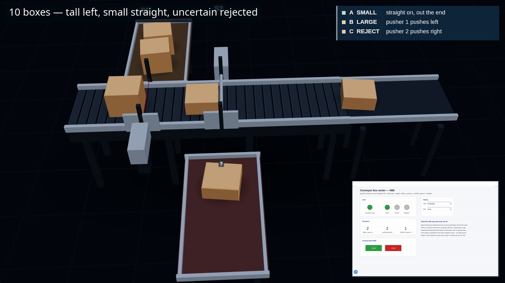
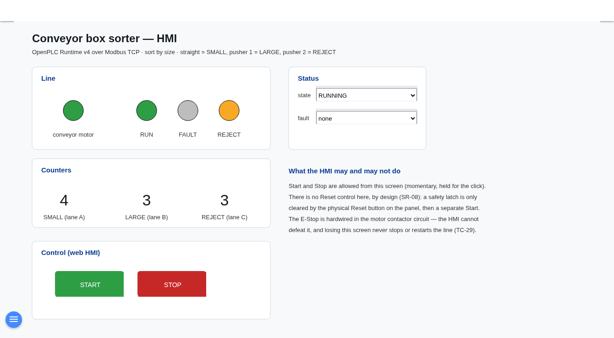
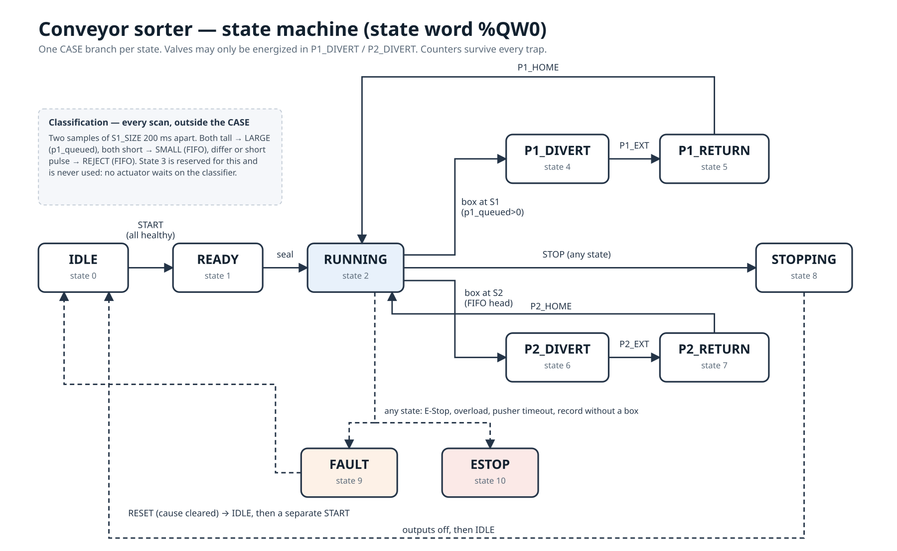
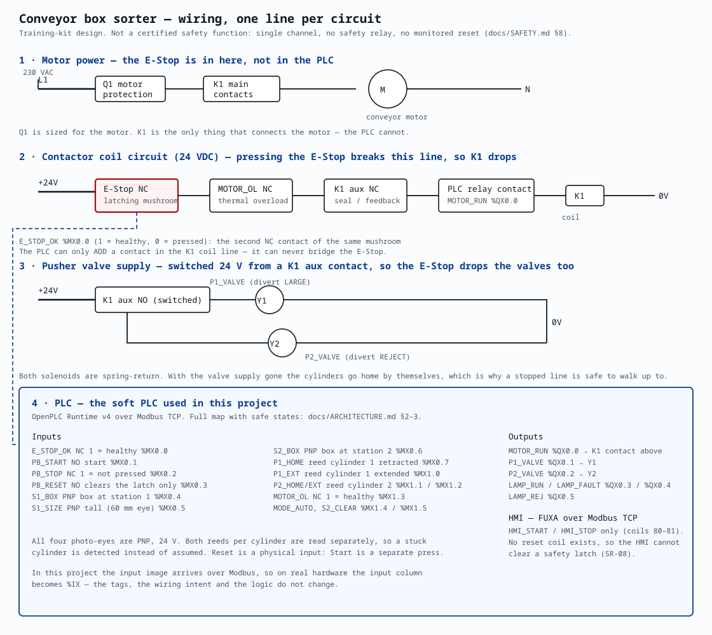
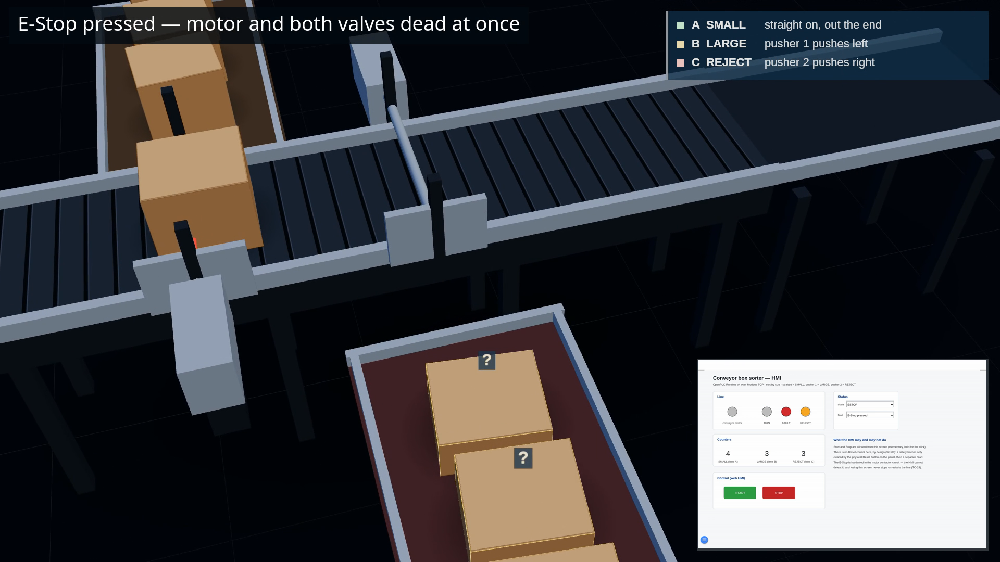
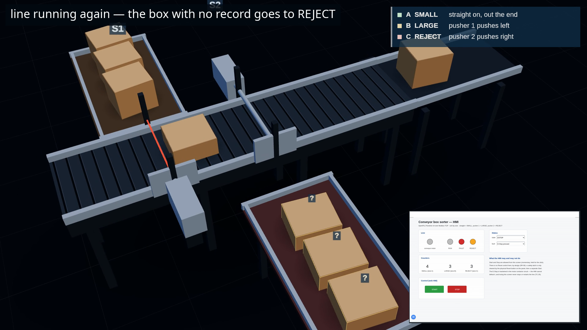

# Project 4 — PLC-Based Conveyor Sorting System

**Three lanes, two pneumatic pushers, and an E-Stop the PLC is not allowed to argue with.**

DecodeLabs Robotics & Automation · Batch 2026 · Track: **Industrial Control & Safety**.
Brief: *"Design the industrial control logic to sort boxes by size or color on an automated
conveyor line."*



*Everything in that frame comes from the running controller — box positions and lane decisions are
the plant simulator's numbers, the motor, both valves, the state, the three counters and the fault
code are the PLC's own coils and holding registers, polled at ~16 Hz. Nothing is a replay.*

| | |
|---|---|
| **Controller** | OpenPLC Runtime v4, IEC 61131-3 **Structured Text state machine** (the brief allows ladder *or* a state machine) |
| **HMI** | FUXA over Modbus TCP — 13 tags, 1 s poll, no reset control by design |
| **Line** | 14 digital inputs, 6 digital outputs, 2 photo-eye stations in series, 3 lanes |
| **Test result** | 10-box acceptance run green · **33 pass / 1 blocked / 0 fail** of 34 cases |
| **Scope** | Simulation only — no hardware was ever connected, and the docs say so everywhere it matters |

**Deliverables** ·
[Report (10 pages, PDF)](docs/report.pdf) ·
[Commented program listing (all 385 lines, PDF)](docs/printout.pdf) ·
[Demo video (57 s, with sound)](docs/demo.mp4) ·
[Live 3D view](viz/index.html) *(open locally: drag to orbit, wheel to zoom)*

## The HMI



Four lamps, the state and the fault cause as text, three counters, START and STOP. That is the whole
screen on purpose: it can stop the line, it cannot clear a safety latch, and losing it changes
nothing — the panel keeps running (TC-29). It polls the PLC once a second (0.41 s measured).

## How a box is sorted

```
         station 1              station 2
  ───────[ eye ]──────────[ eye ]──────────────▶  lane A  straight  = SMALL  (no actuator, fail-safe)
             │                                     ▲
             │  pusher 1 ──────────────────────────┘  lane B  pusher 1 = LARGE
             └  pusher 2 ─────────────────────────────  lane C  pusher 2 = REJECT
```

- The station-1 eye sits 60 mm above the belt. A **tall** box (≥ 100 mm) blocks it, a small box does not.
- Every scan samples the reading, then samples again **200 ms later**. Two clean samples agree on a
  class; anything else is *uncertain* and goes to REJECT rather than being guessed at.
- Classification lives **outside** the state machine, so a busy actuator sequence can never sample air
  where the box used to be. The state machine only drives actuators.
- Lanes are chosen so a failure lands boxes in a safe place: no actuator = the small lane.



## Safety — three layers, one of them outside the PLC



1. **Hardwired stop.** The E-Stop is a latching NC mushroom switch in series with the K1 contactor
   coil. Pressing it drops K1 and the motor loses power **whatever the PLC is doing**, including
   being hung. The same switched 24 V that drops the contactor also removes the valve supply, so
   both pushers spring home.
2. **Program stop.** The PLC reads the same chain, enters `ESTOP` from any state, forces both valve
   outputs off and latches `reset_required`.
3. **Latching and recovery are separate acts.** Releasing the button never restarts the line:
   Reset clears the latch, Start is a second, deliberate input. The HMI can Start and Stop but has
   **no Reset at all** (SR-08), so a screen cannot bypass a safety latch.

Also enforced in the program: pusher extend/return timeouts, never both stations' valves in the same
scan, a pusher that strokes **only while its box is still in the zone** (a stale record raises fault 8
instead of stroking into air), motor overload, and a jam detector for two boxes waiting too long.

## The demo video

| E-Stop pressed mid-divert | Two steps later: running again |
|---|---|
|  |  |

`docs/demo.mp4` — 57 s, 1920×1080, 10 fps, sound. Ten boxes (counters 4 / 3 / 3), the E-Stop above,
the Reset-then-Start recovery, and HMI Stop / Start clicked on the real FUXA buttons, which stay in
the corner as picture-in-picture. One continuous shot, no cuts, real time.

The soundtrack is built by `audio/build.py`: motor bed, air puffs, carton thuds and the E-Stop clunk
are synthesised with numpy, the panel tap is rendered from the **earshot** sound bank, and the mix
lands at −16.1 LUFS / −1.2 dBTP with no clipped samples. Measured with earshot, 24 of 24 sound cues
land on a strong accent within one frame (median 1 ms). Since most of the bed *is* synthesised,
earshot's `realness` honestly returns p_real 0.713 — "uncertain" — and the README and test log say
so instead of claiming a field recording. The earlier HMI-only clip is kept as `docs/hmi.mp4`.

## What the PDF asks for, and where it is answered

| Requirement | Answer |
|---|---|
| **R1** map digital inputs and outputs | `docs/ARCHITECTURE.md` — 14 in / 6 out, tag, address, safe state, and why the inputs sit in `%MX` (no `%IX` producer exists in this runtime) |
| **R2** ladder logic **or** a state machine | `src/conveyor-sorter/conveyor-sorter/pous/programs/main.st` — one `CASE` state machine, commented tag by tag; `docs/printout.pdf` is the full listing |
| **R3** strict safety interlock, E-Stop halts all motors | `docs/SAFETY.md` — three layers above, fault matrix, and a limitations section that starts with "no hardware" |

Everything else — platform, lane count, thresholds, timing — is a decision, recorded with its
reasoning in `docs/DECISIONS.md`.

## Tests and evidence

- `docs/TEST-PLAN.md` — **TC-01 … TC-34** with pass criteria; the safety cases are non-waivable.
- `docs/TEST-LOG.md` — every case with its result and evidence.
- **Run them:** `.venv/bin/python sim/tests.py` (needs the runtime up), or
  `bash sim/run-scenarios.sh` for the six plant scenarios.

| Result | Count | Notes |
|---|---|---|
| PASS | 33 | includes the 10-box acceptance run, both-stations-in-one-scan, and a printout that is fully commented and uses standard IEC instructions only |
| BLOCKED | 1 | **TC-17**, hardware independence of the E-Stop: needs the physical relay kit, which does not exist here. Evidence supplied is the wiring diagram and `docs/SAFETY.md` §2/§7 |
| FAIL | 0 | — |

**Honest limits, stated rather than buried:** no hardware was ever connected, so every safety claim
is design-level; colour is deliberately not implemented (size only — the brief allows either);
throughput (~45 boxes/min) is an assumption from 400 mm pitch at 0.3 m/s, not a measurement; and
`T_debounce` is not implemented — the 20 ms scan plus the 200 ms two-sample classifier are the
filter, and a beam gap inside that window would still read as two boxes (`docs/ARCHITECTURE.md` §8).

## Repo layout

```
src/       OpenPLC project + main.st (the program)
sim/       Python plant simulator over Modbus TCP, 6 scenarios, test runner, demo3d.py
fuxa/      HMI generator (build.py), checker, screenshot tool, project.fuxap
viz/       live 3D view of the line — Three.js vendored locally, no CDN
audio/     soundtrack build for the video
docs/      requirements, PRD, architecture, safety, test plan, test log, decisions
           report.pdf, printout.pdf, build.py (rebuilds both), img/ (diagrams, screenshots)
```

## Quickstart

```bash
# 1. PLC runtime + HMI (stock FUXA image plus modbus-serial)
docker compose up -d --build

# 2. Simulator dependencies
pip install pymodbus python-socketio

# 3. Open the program in OpenPLC Editor v4, connect to localhost:8443, upload, start
# 4. Build the HMI screen and capture it
python3 fuxa/build.py --apply
python3 fuxa/shot.py                  # -> docs/img/fuxa.png

# 5. Sort some boxes
python sim/plant.py --scenario sim/scenarios/acceptance-10.json

# 6. Watch the line move, or re-record the demo
.venv/bin/python sim/demo3d.py --live  # -> http://localhost:8099
.venv/bin/python sim/demo3d.py         # -> docs/demo.mp4

# 7. Rebuild the PDFs (headless Chrome, no PDF library needed)
.venv/bin/python docs/build.py
```

HMI: <http://localhost:1881>. Modbus TCP: port 502, served by the project's own server so the I/O
image sizes come from `project.json`.

## Numbers that are assumptions, not measurements

| Value | Why this number |
|---|---|
| Belt pitch 400 mm, 0.3 m/s | ~45 boxes/min theoretical; replace with real belt data |
| Size threshold 100 mm, eye at 60 mm | tall box blocks the beam, small one does not |
| Cylinder timings: 800 ms extend, 1000 ms return | used for both the stroke and the timeout tests |

## Notes

- The PDF is a 17-slide Canva deck; only the "Project 4" slide carries technical content.
- All documents are written in plain English, and every deviation from the brief is listed in
  `docs/DECISIONS.md` instead of being hidden.
- Milestones P0–P7 are tracked in `TODO.md`.