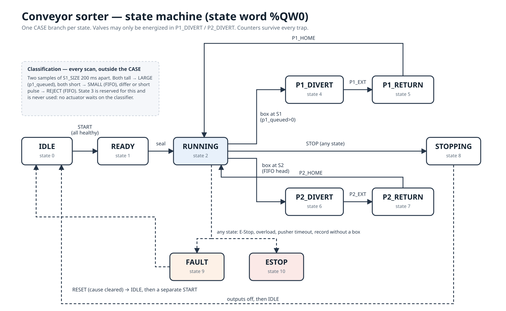
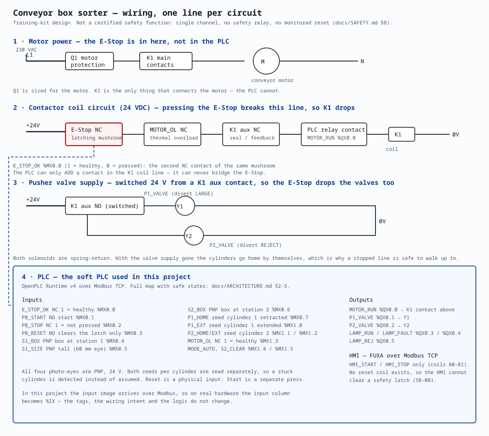
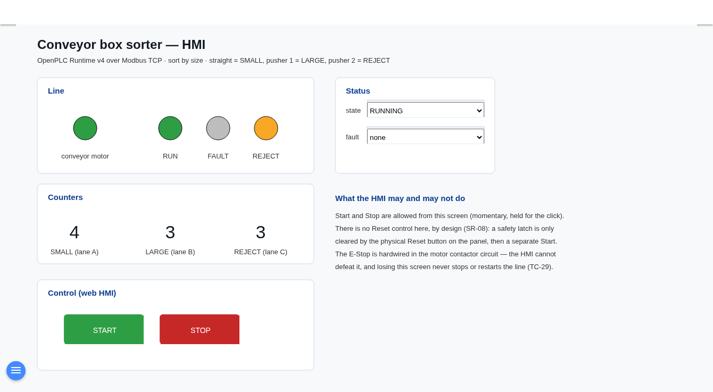
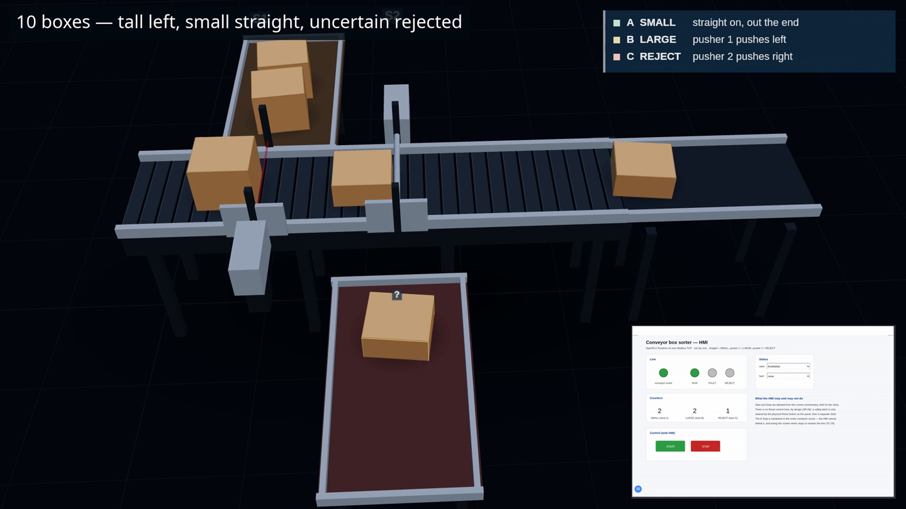

# PLC-Based Conveyor Sorting System

**DecodeLabs Robotics & Automation — Project 4 (optional mastery phase)**

Track: Industrial Control & Safety

Author: Ricou (github.com/ricolazzami) · Batch 2026 · 17 November 2026

Repository: <https://github.com/ricolazzami/decodelabs-conveyor-sorter> (public)

Demo video: `docs/demo.mp4` in the repository · Live 3D view: `viz/` in the repository


## 1. Summary

A conveyor line that sorts boxes by size into three lanes, with the control logic,
the I/O map, a web HMI, a plant simulator and a safety design for the E-Stop. The
program is an IEC 61131-3 **Structured Text state machine** running on OpenPLC
Runtime v4 (the brief allows a ladder diagram *or* a state machine).

The line works: a scripted 10-box run sorts 4 small, 3 large and 3 boxes whose
height reading cannot be trusted, every box in the right lane, counters reading
4 / 3 / 3, and no fault. The safety logic is tested in simulation: the E-Stop is
reachable from every state, both valves drop, the line does not restart by itself,
and a Reset plus a separate Start is needed to recover. **The hardwired E-Stop
itself was not tested on hardware** — no kit exists here — so that one case is
reported as BLOCKED, not as passed. Section 7 says exactly what that means.

| What | Result |
|------|--------|
| Test cases | **33 PASS, 1 BLOCKED, 0 FAIL** out of 34 |
| Fault scenarios | 6 of 6 pass (E-Stop, overload, P1 jam extend, P1 jam return, P2 jam, dead station-1 eye) |
| Acceptance run | 10 boxes, 0 mis-sorts, counters 4 / 3 / 3 |
| I/O map | 14 digital inputs, 6 digital outputs, 27 located tags, all commented |
| HMI | FUXA over Modbus TCP, 13 tags, Start/Stop only, no reset path |


## 2. What the brief asks for

The Project 4 slide of the DecodeLabs deck asks for one thing:

> "Design the industrial control logic to sort boxes by size or color on an
> automated conveyor line."

and then names three deliverables:

| ID | Requirement | Where it is answered |
|----|-------------|----------------------|
| R1 | Map digital inputs (sensors) and outputs (motors, pneumatic pushers) | `docs/ARCHITECTURE.md` §2–§3, repeated in §4 of this report |
| R2 | Write industrial ladder logic **or** a state machine to control the sequence | `src/conveyor-sorter/.../main.st` — a Structured Text `CASE` state machine, described in §5–§6 |
| R3 | Implement strict safety interlocks (e.g. E-Stop logic halts all motors immediately) | `docs/SAFETY.md`; hardwired stop plus PLC bookkeeping, described in §7 |

Everything else in this build — platform, lane count, size threshold, belt speed,
test list — is a decision that is written down in `docs/DECISIONS.md`, not
something the brief specifies. Colour sorting is deliberately **not** built; the
classifier is one block, and §11 explains what changes if colour is wanted.

## 3. What was built

Three lanes, two pushers, two stations in series:

```
 box in ──►  conveyor  ──► [ Station 1: S1_BOX + S1_SIZE ] ──► [ Station 2: S2_BOX ] ──► end
                                    │                                │
                              Pusher 1 (P1)                    Pusher 2 (P2)
                                    │                                │
                             LARGE lane (B)                  REJECT lane (C)

 Straight past both stations = SMALL lane (A)   ← de-energised, fail-safe default
```

Why these choices:

- **Two stations, not one.** Pusher 1 and pusher 2 would collide if they shared a
  zone. Station 1 diverts LARGE boxes; station 2, downstream, diverts REJECT
  boxes. A SMALL box touches neither pusher and leaves on the straight lane, so
  the default (both valves de-energised) is also the safe lane.
- **Size, not colour.** A single photo-eye at 60 mm tells a tall box (≥ 100 mm)
  from a short one, needs no lighting discipline and cannot be fooled by a
  printed label. Colour would replace that one sensor and the classifier block
  only.
- **Uncertain readings go to REJECT, not to SMALL.** If the two samples of the
  height eye disagree, or the box leaves before the second sample, the box is
  counted and rejected. The line never guesses.
- **Simulation only.** No machine was available, so a plant simulator drives the
  PLC over Modbus TCP. That makes every test repeatable, and it is also the
  honest limit of the evidence: it proves logic behaviour, not mechanics.

Platform: OpenPLC Editor 4.3.5 (used headlessly) and OpenPLC Runtime v4 in Docker.
HMI: FUXA, over the runtime's Modbus TCP server. Simulator, test runner, video
and sound tools: Python in `sim/`, `audio/`, `viz/`.


## 4. I/O map

Fourteen digital inputs and six digital outputs. Addresses are the OpenPLC
locations. Because this build is a soft PLC with no fieldbus card, the inputs are
memory bits (`%MX`) written by the simulator; on a machine with an input card the
same tags move to `%IX` and the logic does not change.

| Tag | Address | Type | Device | At rest | Purpose |
|-----|---------|------|--------|---------|---------|
| `E_STOP_OK` | %MX0.0 | NC, 24 V | E-Stop mushroom, latching | **1 = healthy** | Safety feedback |
| `PB_START` | %MX0.1 | NO | Green pushbutton | 0 | Start |
| `PB_STOP` | %MX0.2 | NC | Red pushbutton | 1 | Controlled stop |
| `PB_RESET` | %MX0.3 | NO | Blue pushbutton | 0 | Clears FAULT/ESTOP only |
| `S1_BOX` | %MX0.4 | PNP | Photo-eye, station 1 entry | 0 | Box at station 1 |
| `S1_SIZE` | %MX0.5 | PNP | Photo-eye at 60 mm | 0 | 1 = tall (≥ 100 mm) |
| `S2_BOX` | %MX0.6 | PNP | Photo-eye, station 2 entry | 0 | Box at station 2 |
| `P1_HOME` | %MX0.7 | PNP | Reed, cylinder 1 retracted | 1 | Pusher 1 safe position |
| `P1_EXT` | %MX1.0 | PNP | Reed, cylinder 1 extended | 0 | Stroke complete |
| `P2_HOME` | %MX1.1 | PNP | Reed, cylinder 2 retracted | 1 | Pusher 2 safe position |
| `P2_EXT` | %MX1.2 | PNP | Reed, cylinder 2 extended | 0 | Stroke complete |
| `MOTOR_OL` | %MX1.3 | NC | Thermal overload / drive fault | 1 = healthy | Fault input |
| `MODE_AUTO` | %MX1.4 | NO | Auto/manual selector | 0 | Forced 1 in simulation |
| `S2_CLEAR` | %MX1.5 | PNP | Photo-eye, station 2 exit | 0 | Confirms the box left |

| Tag | Address | Load | De-energised | Purpose |
|-----|---------|------|--------------|---------|
| `MOTOR_RUN` | %QX0.0 | Contactor K1 coil | Motor off | Conveyor, also in series with the E-Stop contact |
| `P1_VALVE` | %QX0.1 | 5/2 solenoid Y1 | Retracted | Divert LARGE (lane B) |
| `P2_VALVE` | %QX0.2 | 5/2 solenoid Y2 | Retracted | Divert REJECT (lane C) |
| `LAMP_RUN` | %QX0.3 | Green lamp | Off | Running |
| `LAMP_FAULT` | %QX0.4 | Red lamp | Off | Fault or E-Stop |
| `LAMP_REJ` | %QX0.5 | Amber lamp | Off | A box went to reject (1 s pulse) |

The counters, the state word and the fault code are **not** outputs. They live in
holding registers for the HMI: `ST_WORD`, `CNT_SMALL`, `CNT_LARGE`, `CNT_REJECT`
and `FAULT_CODE` in `%QW0`–`%QW4`.


## 5. Sequence and state machine

The program has two layers, on purpose.

**Classification runs on every scan, outside the state machine.** A box at
station 1 is sampled at the rising edge and again 200 ms later. Both samples tall
means LARGE; both short means SMALL; disagreeing samples mean REJECT; a box that
leaves before the second sample is REJECT. This cannot wait for the sequencer:
the box is only under the eye for about a second, and a busy actuator sequence
would sample air and turn a good box into "unclassified". State 3 is reserved for
this layer and is deliberately never used.

**The actuator sequence is the state machine.** LARGE boxes are counted in
`p1_queued` and diverted at station 1, so they never reach station 2 and stay out
of its FIFO. SMALL and REJECT boxes go into that FIFO in arrival order and are
decided at station 2. `RUNNING` serves station 1 first, because a box is in
pusher 1's zone for about one second while a station-2 arrival can wait in a
latch without being lost.

| # | State | MOTOR | P1 | P2 | Exit | Traps |
|---|-------|-------|----|----|------|-------|
| 0 | `IDLE` | 0 | 0 | 0 | Start + all healthy | — |
| 1 | `READY` | 0 | 0 | 0 | run seal set | — |
| 2 | `RUNNING` | 1 | 0 | 0 | box at S1, box at S2, Stop, fault | — |
| 3 | *(reserved)* | 1 | 0 | 0 | unused — classification runs outside the `CASE` | — |
| 4 | `P1_DIVERT` | 1 | 1 | 0 | `P1_EXT` | extend timeout → fault 2 |
| 5 | `P1_RETURN` | 1 | 0 | 0 | `P1_HOME` | return timeout → fault 3 |
| 6 | `P2_DIVERT` | 1 | 0 | 1 | `P2_EXT` | extend timeout → fault 4 |
| 7 | `P2_RETURN` | 1 | 0 | 0 | `P2_HOME` | return timeout → fault 5 |
| 8 | `STOPPING` | 0 | 0 | 0 | always → `IDLE` | — |
| 9 | `FAULT` | 0 | 0 | 0 | Reset, cause cleared | — |
| 10 | `ESTOP` | 0 (hardware) | 0 | 0 | Reset **and** `E_STOP_OK` | — |



Rule enforced twice (state mapping plus an output guard): `P1_VALVE` may be 1
only in `P1_DIVERT`, `P2_VALVE` only in `P2_DIVERT`, and both are forced off
whenever the safety chain is not healthy.

## 6. The program

`src/conveyor-sorter/conveyor-sorter/pous/programs/main.st` — 385 lines of
Structured Text, 60 declared tags, every tag and every state branch commented
(TC-33 checks this automatically). The layout follows the five groups in
`docs/ARCHITECTURE.md` §6:

| Group | Content |
|-------|---------|
| G1 Safety and enable | `E_STOP_OK`/`MOTOR_OL` normalisation, run seal, `reset_required` latch |
| G2 State machine | one `CASE` branch per state, guards, station-2 FIFO, `p1_queued` |
| G3 Outputs | state → motor, valves, lamps; one coil per tag, in one block |
| G4 Timers and faults | settle, extend ×2, return ×2, reject-lamp pulse, fault latch |
| G5 Counters | `CNT_SMALL`, `CNT_LARGE`, `CNT_REJECT` |

Choices worth defending:

- **Structured Text, not ladder.** The brief allows either. A `CASE` state
  machine with a FIFO and an arrival-order classifier is clearer as text than as
  40 rungs, and the state numbers map straight onto the HMI word.
- **One coil per tag, written only in the output block.** No coil is set from two
  places, so "the last write wins" can never hide a bug.
- **Timers reset by their own state exit**, not by first scan, so a re-entered
  state always gets a full guard time.
- **A pusher strokes only while its box is in the zone (SR-06).** If the record
  exists but the box is gone — lifted off by hand, or it outran the sequence —
  the PLC raises fault 8 instead of stroking into air, and the box is not allowed
  to slip down the SMALL lane as if it had been checked.
- **No `T_debounce`.** The 20 ms scan plus the 200 ms two-sample classification
  are already the filter. What that does not cover is stated as a limitation in
  §11: a beam gap inside the 200 ms window reads as two boxes; the fix at the
  bench is a hardware debounce, not more PLC code.
- **Fault and E-Stop clear the tracking, never the counters.** Counts are
  production data; losing them on a stop would be a defect.

The commented listing is `docs/printout.pdf` (all 385 lines, with page headers).
It is a Structured Text printout rather than a ladder printout because the
program is not ladder — the brief's "ladder **or** state machine" allows this,
and TC-34 confirms the printout uses only standard IEC types and the `TON`
block, with no vendor-specific names.


## 7. Safety

### 7.1 Three requirements, three layers

"Halts all motors immediately" is only true if three things hold: the stop happens
within one scan, it works even when the PLC is hung, and the machine cannot
restart by itself. Only hardware can promise the second one, so the design is
layered.

**Layer 1 — hardwired stop (the real safety function).** The E-Stop is a latching
NC mushroom in series with the K1 contactor coil. Pressing it drops K1 and motor
power goes away regardless of the PLC. Both pusher valves sit on the same
switched 24 V rail, so they de-energise and spring-return home. The PLC output
cannot energise the motor on its own; it has to pass through the E-Stop contact.



**Layer 2 — PLC logic.** The PLC reads `E_STOP_OK`, enters `ESTOP` from any state,
forces both valves off, latches `reset_required`, and requires
**released AND Reset**, followed by a separate **Start**. Releasing the button
alone never resumes the line. Recovery is deliberately two steps.

**Layer 3 — fault interlocks.** Pusher extend and return timeouts, motor
overload, a box stuck between stations for 3 s, and a pusher record with no box
in the zone all latch into `FAULT` with a cause code. Faults are not reset by the
HMI: the web screen has no reset control at all (SR-08), because a fault latch
must not be clearable from a browser.

| Code | Fault | Reaction |
|------|-------|----------|
| 1 | E-Stop pressed | `ESTOP`, motor (hardware) and both valves off |
| 2 / 3 | Pusher 1 did not extend / return | valve off, `FAULT` |
| 4 / 5 | Pusher 2 did not extend / return | valve off, `FAULT` |
| 6 | Motor overload / drive fault | motor off, both valves off, `FAULT` |
| 7 | Box stuck between stations > 3 s | motor off, `FAULT` |
| 8 | Pusher record with no box in the zone | valve never energised, `FAULT` |
| — | Unclassified box | REJECT lane + amber lamp, counted, **not** a fault |

### 7.2 What is proven and what is not

Simulation proves the logic: E-Stop pressed in states 0, 2, 4, 5, 6, 7 and 9
always ends in `ESTOP` with the motor and both valves off (TC-15, TC-16), and a
valve that was energised drops and its cylinder returns (TC-26). It does **not**
prove that the contactor really opens.

**TC-17 (hardware independence) is BLOCKED.** The test is: force `MOTOR_RUN` = 1
with the E-Stop pressed and confirm the motor stays off. That needs the physical
relay kit, which is not available. The evidence is the wiring diagram above plus
`docs/SAFETY.md` §2 and §7; the case is reported BLOCKED and must not be counted
as passed.

### 7.3 Honest limitations

- Single channel, no safety relay, no monitored reset: Category B/1 at best. No
  risk assessment to ISO 12100 was done, and nothing here is certified to
  ISO 13849 or IEC 62061.
- No guards, light curtains or two-hand control are modelled. They are named in
  `docs/SAFETY.md` §6 as mechanical/operational gaps, not faked in logic.
- The web HMI is not part of any safety function.
- A software-only E-Stop would be a defect, and is listed under "Never do" in
  `TODO.md`.


## 8. HMI



A FUXA screen over Modbus TCP shows the conveyor motor, the RUN/FAULT/REJECT
lamps, the state and fault as text, the three counters, and START/STOP. It polls
the PLC once a second. Three things about it are deliberate:

- **No Reset.** The screen can start and stop the line; it cannot clear a fault
  latch (SR-08). Only the physical Reset input can.
- **Losing it changes nothing.** With FUXA stopped for 2 s the line kept running,
  was stopped and restarted from the panel only, and the counters survived
  (TC-29).
- **Start/Stop are momentary** (`mousedown`/`mouseup`), so a held mouse does not
  behave like a maintained command.

The screen is generated by `fuxa/build.py`; the generator is the source of truth
and the FUXA JSON is a build artefact, so the tag map has one place to change.


## 9. Verification

Everything was tested against the live runtime over Modbus TCP, from a scripted
plant simulator (`sim/`). The simulator models the belt, the box queue, both
stations, both cylinders and their reed sensors, and can inject faults: E-Stop,
overload, a jammed pusher (extend or return), and a dead station-1 eye. A test
runner (`sim/tests.py`) reloads the program from a clean state for every case and
reads back coils, words and box logs.

**34 cases, 33 PASS, 1 BLOCKED, 0 FAIL.** The full log, one line of evidence per
case, is `docs/TEST-LOG.md`. What the groups cover:

| Group | Cases | Result |
|-------|-------|--------|
| I/O map against the program, cold start, start/stop | TC-01–TC-06 | 6 PASS |
| Three lanes, edge rule, two boxes at once | TC-07–TC-14 | 8 PASS |
| Safety: E-Stop coverage, two-step recovery, timeouts, SR-06, overload, no HMI reset | TC-15–TC-26 | 11 PASS, 1 BLOCKED |
| HMI agreement, poll time, HMI outage, no reset widget | TC-27–TC-30 | 4 PASS |
| Scenario set, concurrent station service, comment coverage, standard instructions | TC-31–TC-34 | 4 PASS |

Notable evidence:

- Six fault scenarios run from a clean PLC state, all six pass (`TC-31`).
- TC-32 serves both stations in the same scan for 10 ticks with no skipped state
  and no moment where both valves are energised.
- TC-33: 60 declared tags and 11 state branches, none without a comment.
- TC-34: only `BOOL`, `INT`, `ARRAY[0..7] OF INT` and `TON`, with no vendor names
  — the listing is portable.

**Acceptance run.** `sim/scenarios/acceptance-10.json` pushes ten boxes: four
small, three large, three with an untrustworthy height reading. Every box lands
in the expected lane, counters read 4 / 3 / 3, no fault, and the run was repeated
three times with the same result.

**Deviations, stated openly.** `T_debounce` is not implemented (§6). The inputs
are `%MX` rather than `%IX` because the soft PLC has no input card (§4). TC-17 is
blocked for lack of hardware (§7.2). None of these is a test that was failed and
then removed; each is a design decision or a missing resource, recorded where a
reviewer will find it.


## 10. Demo video and 3D view

`docs/demo.mp4` is 57 s at 1920×1080, 10 fps, with sound. It shows the whole
acceptance run, the E-Stop pressed while pusher 1 is energised, the two-step
recovery, and HMI Stop/Start clicked on the real FUXA buttons, which stay in a
corner of the frame.

The animation is live, not a replay. Box positions and lane decisions are the
plant simulator's own numbers; the motor, both valves, the state word, the
counters and the fault code are the PLC's coils and holding registers, polled at
about 16 Hz. If the video shows a pusher stroking or a counter climbing, the
controller did it. `viz/` is the same page and can be opened by hand: drag to
orbit, wheel to zoom, `sim/demo3d.py --live`.



The soundtrack is built by `audio/build.py`. The motor bed, air puffs, carton
thuds and the E-Stop clunk are synthesised with numpy; one panel tap is rendered
from the **earshot** sound bank. The bed is band-limited noise with the gear whine
kept and no mains tone — a 50 Hz tone with harmonics droned, so it was removed
and verified by FFT (50–300 Hz now within +6.9 dB of the local noise floor,
against +34 to +39 dB before). The deliverable measures −16.1 LUFS integrated
and −1.2 dBTP true peak, with no clipped samples; all 24 sound cues land within
one frame of their event. `earshot realness` reports p_real 0.713, "uncertain",
with 4 of 15 windows leaning synthesised — which is honest: most of the bed *is*
synthesised, and the report says so rather than claiming a field recording.


## 11. Limitations and next steps

- **No hardware.** Every safety claim is design-level. The first thing to do with
  a kit is TC-17: press the E-Stop with `MOTOR_RUN` forced on and watch the
  contactor. Then repeat the acceptance run on a real belt to replace the 0.3 m/s
  and 400 mm assumptions with measurements.
- **Colour is not implemented.** Swapping size for colour touches one sensor and
  the classifier block; the lanes, sequence, safety logic and HMI stay.
- **Throughput is an assumption** (~45 boxes/min at 400 mm pitch and 0.3 m/s),
  not a measurement. No number is claimed beyond that.
- **One box between stations at a time.** The FIFO keeps arrival order, but the
  design assumes boxes do not overtake each other; a jam is caught as fault 7.
- **Debounce gap.** A beam interruption inside the 200 ms classification window
  would be read as two boxes (§6). Hardware debounce is the fix.
- **A second size class** would use the spare inputs and a third station; it is
  in `TODO.md` under "stretch", not built.

## 12. Conclusion

The brief asks for an I/O map, a sequence and a safety interlock that stops the
motors immediately. This build delivers all three in a form an engineer can
review: a 14-in/6-out map with safe states, a commented Structured Text state
machine with a classification layer that cannot be starved, and an E-Stop that is
hardwired into the contactor circuit with the PLC only doing the bookkeeping.
The sorting behaviour is proven in simulation — 10 of 10 boxes, three runs, six
fault scenarios, 33 of 34 tests passing — and the one case that cannot be proven
without hardware is reported as blocked instead of being talked around.

## Appendix A — Repository map and how to run it

```
src/conveyor-sorter/   OpenPLC project, Structured Text in pous/programs/main.st
sim/                   plant simulator, six scenarios, test runner, demo3d.py
fuxa/                  HMI generator, screenshot helper, thin Docker layer
viz/                   live 3D view (Three.js vendored, no CDN)
audio/                 soundtrack build for the demo video
docs/                  requirements, architecture, safety, test plan, test log, this report
docs/printout.pdf      commented Structured Text listing (all 385 lines)
docs/demo.mp4          demo video · docs/hmi.mp4 the earlier HMI-only clip
```

```bash
docker compose up -d --build          # runtime on 8443 TLS, Modbus 502, FUXA on 1881
pip install pymodbus python-socketio  # simulator dependencies
python3 fuxa/build.py --apply         # rebuild the HMI screen
.venv/bin/python sim/tests.py         # TC-01 ... TC-34 -> docs/TEST-LOG.md numbers
bash sim/run-scenarios.sh             # six fault scenarios
.venv/bin/python sim/demo3d.py --live # 3D view on http://localhost:8099
.venv/bin/python sim/demo3d.py        # re-record docs/demo.mp4
```

The OpenPLC project is uploaded with the editor CLI
(`--cli upload <project> --host 127.0.0.1 --target "OpenPLC Runtime v4"`), with
credentials in the environment, never in the repository.

<!-- pagebreak -->

## Appendix B — Document set

| File | Content |
|------|---------|
| `docs/REQUIREMENTS.md` | traceable requirements and non-functional targets |
| `docs/PRD.md` | problem, users, scope, risks, milestones |
| `docs/DECISIONS.md` | every design decision and the one open question |
| `docs/ARCHITECTURE.md` | layout, I/O map, sequence, state table, timing, HMI map |
| `docs/SAFETY.md` | E-Stop layers, fault table, safety matrix, limitations |
| `docs/TEST-PLAN.md` | TC-01 ... TC-34, with pass criteria |
| `docs/TEST-LOG.md` | executed results, evidence, video and audio measurements |
| `docs/printout.pdf` | commented Structured Text listing with page headers |
| `docs/demo.mp4` | the demonstration video |